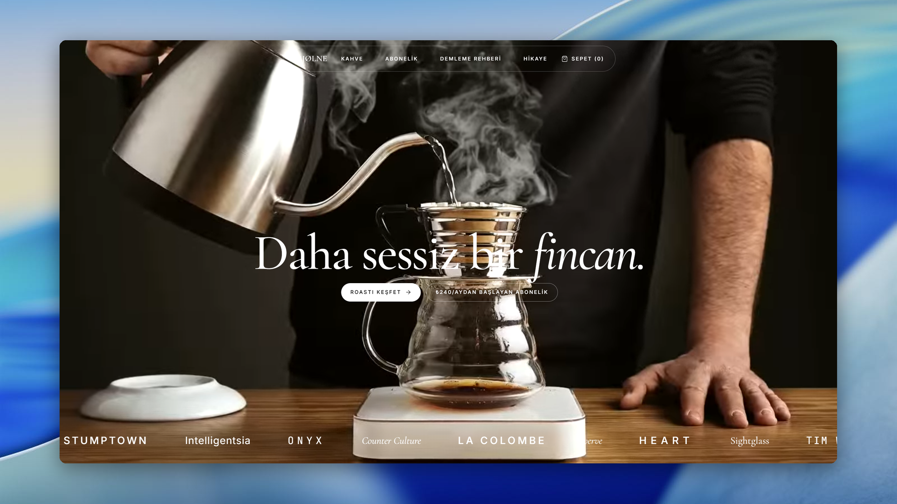
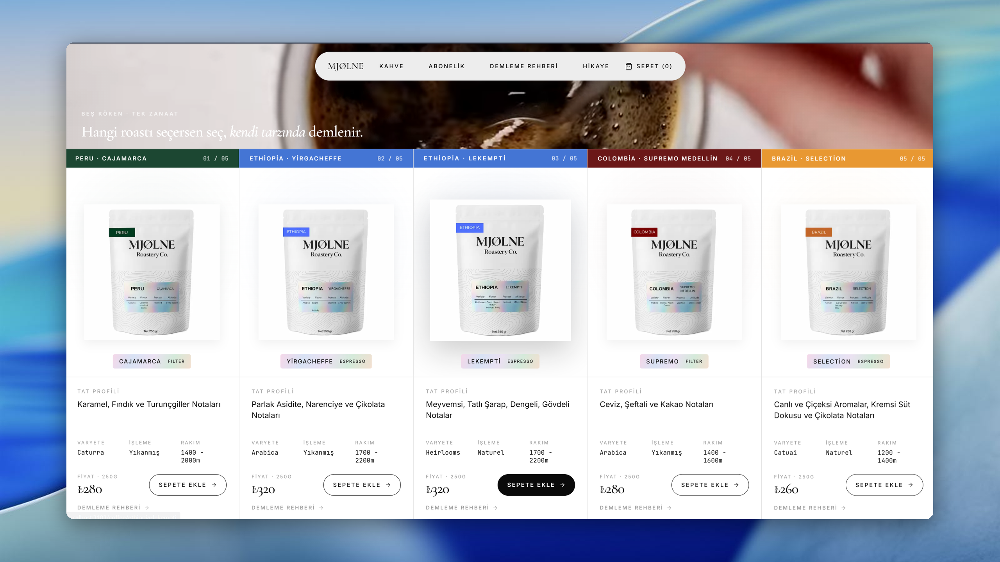

# MJØLNE Roastery Co.

Brand-led e-commerce site for a specialty coffee roastery: story, brew guides,
product pages, a subscription configurator, cart and checkout, and customer
accounts for recurring bean delivery.

Built solo, 2026. Next.js, TypeScript, Tailwind.

Status: archived - no longer deployed.

